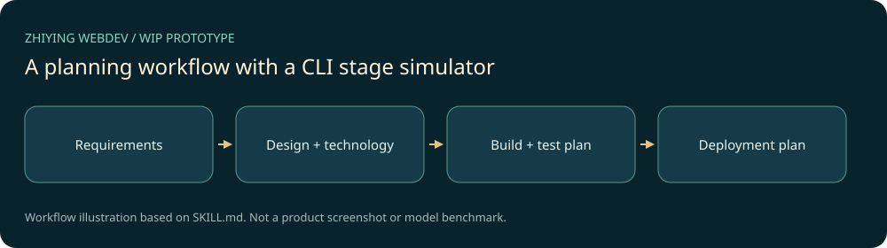

# 职映 WebDev · 六阶段工作流原型

本机AI辅助定制的网页开发Skill与Python状态机原型，保全需求、设计、技术、开发、测试和部署六个阶段的指令、参考与模板。**开发中：Python CLI当前只打印阶段信息并切换内存状态，没有接入真实生成器、构建器、测试器或部署服务。**



## 快速体验

CLI只依赖Python3.9+标准库，无需Node、API密钥或云端账号：

```powershell
python -X utf8 src/index.py --help
python -X utf8 src/index.py --mode interactive
```

输入`/status`查看阶段、`/help`看命令、`/quit`退出。参数演示：

```powershell
python -X utf8 src/index.py --mode batch --requirement examples/sample_requirement.md --design examples/sample_design.md
```

该命令仅打印模拟流程，不产出网站或上传任何内容。`--output`和`--stage`虽保留在历史参数中，当前未被实际使用。

在支持`SKILL.md`的宿主中，将本目录复制到个人技能目录的`zhiying-webdev/`，先审阅已有目录避免覆盖，再按宿主方式刷新。使用`$zhiying-webdev`加载当前可移植入口；宿主实际执行开发仍取决于可用工具、用户授权和真实产物。

## 文件与实现情况

```text
SKILL.md              当前可移植入口，明确授权与原型边界
src/index.py          交互/参数演示与阶段控制器
src/stateManager.py   内存状态、回退和序列化接口
references/           六个阶段的规则
templates/ prompts/   原有需求/规格模板与系统提示
examples/             需求与演示设计输入
antigravity/          原平台指令格式，非当前Codex入口
```


## 验证、许可与后续

本次实际运行帮助、交互状态/退出和带两个真实示例文件的批量流程，均正常退出；没有生成输出文件、网络调用或真实部署。官方Skill格式校验通过；源码/差异两轮默认敏感扫描见本地审计。[VALIDATION.md](VALIDATION.md)说明边界。

原README已声明MIT；本机开发目录、`agent_created`标记和配套自有示例构成本机定制原型的证据，未发现第三方商店来源或外部实现包。按用户对自有项目的授权补全[MIT](LICENSE)，详细范围见[PROVENANCE.md](PROVENANCE.md)。

下一步应先实现一个真实最小网页产物及其验证，再接入其他阶段；增加真实副作用前先定义授权和失败恢复。更新见[CHANGELOG.md](CHANGELOG.md)。

## 安装范围


安装当前根目录及运行资源；Python入口仍只演示阶段流转。
